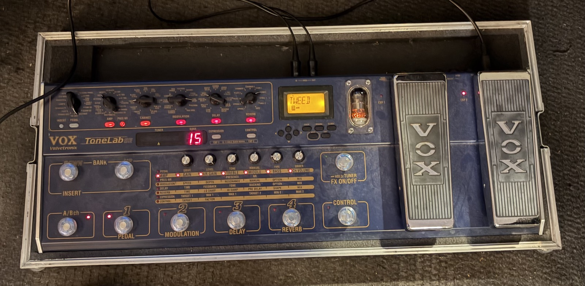
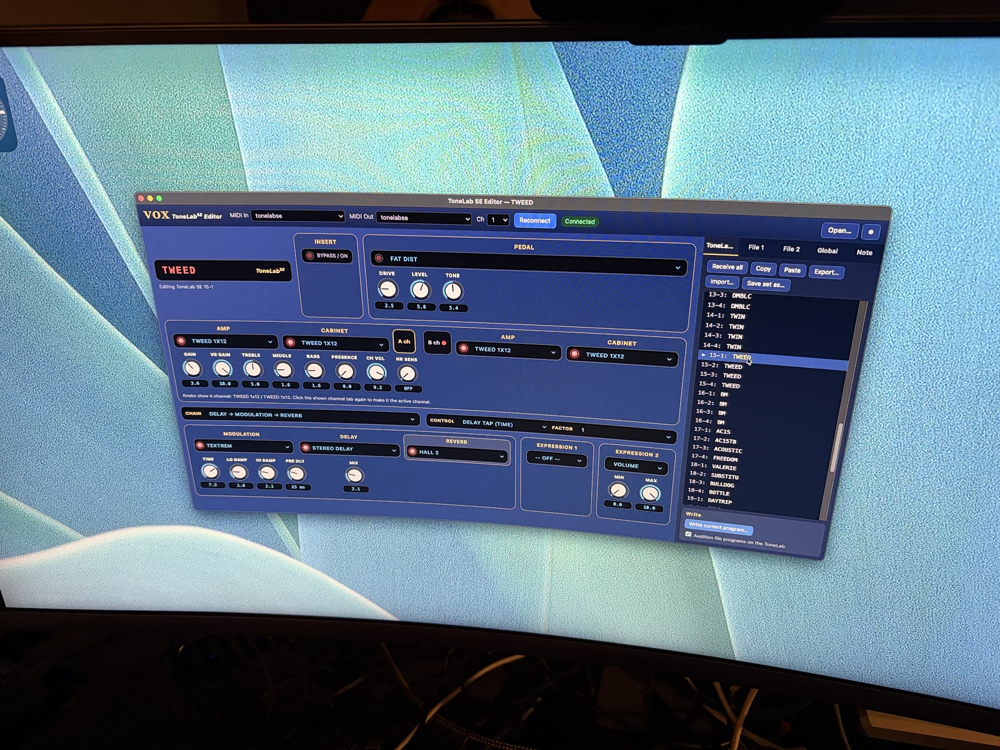

# ToneLab SE Editor

This is an editor and librarian for the **VOX ToneLab SE**. It replaces Korg's *ToneLabSE SoundEditor* (2004), whose PowerPC Mac version no longer runs on current Macs. It was rebuilt from the original Windows program and Korg's own MIDI specification, and runs natively on Apple Silicon.





It does what the original did:

- **Edit window:** every amp, cabinet, pedal, modulation, delay and reverb parameter, the chain, the control pedal and both expression pedals. Edits are sent to the pedal live, and knob moves on the pedal show up in the editor.
- **Librarian:** the pedal's 96 programs plus two file sets (File 1 and File 2):
  - copy, cut, paste and clear;
  - receive and transmit single programs or all of them;
  - write the current program;
  - import and export single programs.
- **Files:** `.TLP` program sets and `.TLG` global files in the original format. Files from the original **ToneLab** editor are converted for the SE, exactly as the original converter did.
- **Global tab:** MIDI messages, CC assignments and output select.
- **Note tab:** VOX's descriptions of the amp and cabinet models.
- **Preferences:** automatic SysEx Out, careless-program-change warnings and text colour.

## Running it on your Mac

You need a USB-MIDI interface, with MIDI cables to the ToneLab SE's MIDI IN and OUT.

### Option A: download the app

Get the archive for your computer from the [latest release](https://github.com/alienbrainfarm/voxtonelabse-edit/releases/latest). None of the builds are signed with a paid developer certificate, so each system complains once on first launch:

- **macOS** (`macOS-arm64` for Apple Silicon, `macOS-x64` for Intel): unzip, drag `ToneLab SE Editor.app` into `/Applications`. macOS blocks it the first time. Open it once, then go to **System Settings → Privacy & Security** and click **Open Anyway**. Or, in Terminal:

  ```bash
  xattr -d com.apple.quarantine "/Applications/ToneLab SE Editor.app"
  ```

- **Windows** (`Windows-x64`): unzip anywhere, open the folder and run `ToneLab SE Editor.exe`. SmartScreen shows "Windows protected your PC": click **More info**, then **Run anyway**. Windows' own class-compliant USB-MIDI driver is enough; no extra driver is needed.

- **Linux** (`Linux-x64`): extract and run `./ToneLab\ SE\ Editor` from the extracted folder. MIDI goes through ALSA, so any interface that shows up in `aconnect -l` works. On distributions that restrict unprivileged user namespaces (Ubuntu 24.04 and later among them) Electron refuses to start until its sandbox helper is made setuid root, once, from inside the extracted folder:

  ```bash
  sudo chown root:root chrome-sandbox && sudo chmod 4755 chrome-sandbox
  ```

### Option B: build it yourself

1. Install Node.js from <https://nodejs.org> (LTS), or with `brew install node` on a Mac.
2. In a terminal, run:

   ```bash
   git clone https://github.com/alienbrainfarm/voxtonelabse-edit.git
   cd voxtonelabse-edit
   npm install
   npm run build
   ```

This writes an archive for the machine you are on into `dist/`, exactly like the ones on the releases page. On a Mac, `bash scripts/build-mac.sh` does the same without the archive and leaves the app ready to drag into `/Applications`.

### Option C: use it in the browser

Open <https://alienbrainfarm.github.io/voxtonelabse-edit/> in **Google Chrome** or **Microsoft Edge** and allow MIDI access when asked. Nothing is installed and nothing leaves your computer; the page talks to the pedal directly through the browser's Web MIDI. Safari has no Web MIDI, so it won't work there. The same page is `app/index.html` in this repo if you would rather open it locally.

### First connection

1. On the ToneLab SE, open the Global menu and set **System Exclusive Out** to *On*. The editor also turns this on automatically when it connects; you can change that under ⚙ Preferences.
2. In the editor, choose your interface under **MIDI In** and **MIDI Out**, then click **Connect**. The editor finds the pedal's MIDI channel by itself. It then reads all 96 programs, the current program and the Global settings.
3. If you don't have the pedal connected, choose **Simulated ToneLab SE** for both ports. It behaves like the hardware, so you can try the editor.

## Status

| What | Status |
|---|---|
| MIDI messages, program layout, parameter ranges | Match Korg's official *ToneLabSE MIDI Implementation 1.0* and the original editor's code |
| `.TLP` reading and writing | Byte-identical with the factory preset file written by the original editor |
| ToneLab → ToneLab SE conversion | Ported from the original's converter. All 96 original factory presets convert to valid SE programs |
| Editor ↔ pedal flows | Tested against the built-in simulator, in Chrome and in the packaged Electron app |
| **Real ToneLab SE hardware** | **Not tested yet.** Please try it carefully, and save your programs to a `.TLP` first (ToneLab SE tab → *Save set as…*) |
| **macOS build** | The build script is written but has not yet been run on a Mac. The Electron shell itself was checked on Windows (it gets MIDI with SysEx access). |

## Project layout

```
app/            the editor (HTML/CSS/JS, no dependencies)
  js/sysex.js     SysEx framing, Korg 7-bit packing, message builders and parser
  js/model.js     92-byte program model, parameter addresses
  js/params.js    every parameter: ranges, display formats, defaults, expression targets
  js/files.js     .TLP / .TLG container
  js/convert.js   original ToneLab → ToneLab SE program conversion
  js/midi.js      Web MIDI transport;  js/simulator.js  software ToneLab SE
  js/app.js       UI and librarian
electron/       native app shell (grants Web MIDI + SysEx)
scripts/        build.js (any platform, makes the release archive), build-mac.sh, package.js
.github/        CI, release builds (on version tags) and the GitHub Pages deploy of app/
tests/          node tests/run.js   (codec, parameter spec, files, conversion)
docs/           reverse-engineering notes (see below)
reference/docs/ Korg MIDI implementation documents, from VOX UK's download area via the Wayback Machine
```

Korg's original software is not in this repository: the Windows installer (`original/`), the files extracted from it (`extracted/`: `SeTnLbSE.EXE`, factory presets, manuals, bitmaps) and the official Mac editor disk images (`reference/mac/`). They are listed in `.gitignore`.

Some tests check against Korg's factory preset files, and are skipped when those files are missing. To run them, put `ToneLabSE_Preset.TLP` and `ToneLab_Preset.TLP` from the original installer in `extracted/cab/`, or set `TONELAB_PRESETS` to the folder that holds them.

## How it was reverse engineered

- **Installer:** `Setup.exe` is InstallShield wrapping an MSI. The editor (`SeTnLbSE.EXE`), the presets and the manuals were extracted from the MSI's embedded CAB.
- **Ghidra:** the EXE was analysed through the Ghidra MCP. The addresses in `docs/` and in code comments refer to that EXE.
- **Docs:**
  - `docs/re-notes-initial.md`: the SysEx framing, program layout and parameter addressing, recovered from the binary.
  - `docs/params.md`: display formats, per-type defaults, and what happens when an effect type changes.
  - `docs/protocol.md`: the editor's MIDI flows (startup, echo suppression, ACK handling, write).
  - `docs/files-global.md`: the global layout, the file container, and the ToneLab → SE conversion.
- **Official spec:** Korg's own MIDI implementation (`reference/docs/tonelabse_midi.pdf`) was found partway through. It confirmed the reverse-engineered findings and filled in the value tables.

## License

This editor exists so that people who own a ToneLab SE can keep using it. Korg's original SoundEditor is defunct and no longer runs on current Macs, and this project was reverse engineered from it to fill that gap. It is licensed for personal use accordingly.

Free for personal, hobby, research, educational and other non-commercial use under the [PolyForm Noncommercial License 1.0.0](LICENSE). Commercial use is not permitted without a separate agreement from the author.

VOX, ToneLab and Valvetronix are trademarks of Korg Inc. This project is not affiliated with or endorsed by Korg or VOX.
